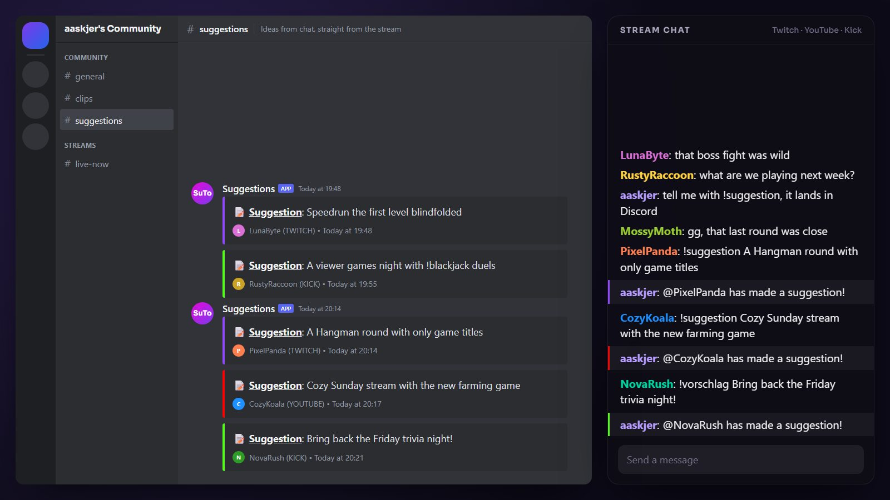

  

<h1 align="center">SuTo — Suggestions To</h1>

  <b>Suggestions from your chat, straight into your server.</b> 
  From Twitch, YouTube and Kick to Discord, Stoat or GameVox.

  
  
  
  
  
  
  

  <a href="https://github.com/aaskjer/SuTo/releases/latest"><b>Download</b></a> &nbsp;·&nbsp;
  <a href="Setup-Guide.md"><b>Setup Guide</b></a> &nbsp;·&nbsp;
  <a href="Import-String.md"><b>Import String</b></a> &nbsp;·&nbsp;
  <a href="https://github.com/aaskjer/SuTo/issues"><b>Report a problem</b></a>

---

## 📖 Overview

SuTo is an import for Streamer.bot. A viewer types `!suggestion Play the new farming game on Sunday` in
chat, and a moment later the idea sits in your server: who sent it, where from and when. The viewer gets a
short confirmation in chat. `!vorschlag` works the same way.

## ✨ Highlights

- 💬 **Three chats in.** Twitch, YouTube and Kick. The action works out by itself which platform a message
  came from.
- 📬 **Three servers out.** One action each for Discord, Stoat and GameVox. Turn on one, two or all three.
- 🎨 **A tidy post.** An embed coloured per platform, with the viewer's avatar, name, platform, date and time.
  Discord shows the time in each reader's own time zone.
- 🧵 **Discord forums.** A new forum post for every suggestion, or all of them in one thread.
- 📡 **Several channels at once.** Enter more than one webhook URL, separated by commas.
- ✏️ **Your wording.** The text of the post, the colours, the footer and the chat reply are all yours to
  change.
- ✅ **Confirmed only when it arrived.** The chat reply goes out on the platform the suggestion came from, and
  only once the post went through.
- 🔒 **No webhook token in your logs.** When something fails, the log says what and why, with the secret part
  of the URL masked.

---

## Credits

- **Author:** [aaskjer on Twitch](https://twitch.tv/aaskjer) · [aaskjer.github.io](https://aaskjer.github.io/)
- **Built for:** [Streamer.bot](https://streamer.bot) by [nate1280](https://www.patreon.com/c/nate1280/home)
- **Thanks:** YOU ♡

Not affiliated with Streamer.bot, Twitch, YouTube, Kick, Discord, Stoat or GameVox. All names and trademarks
belong to their respective owners.
