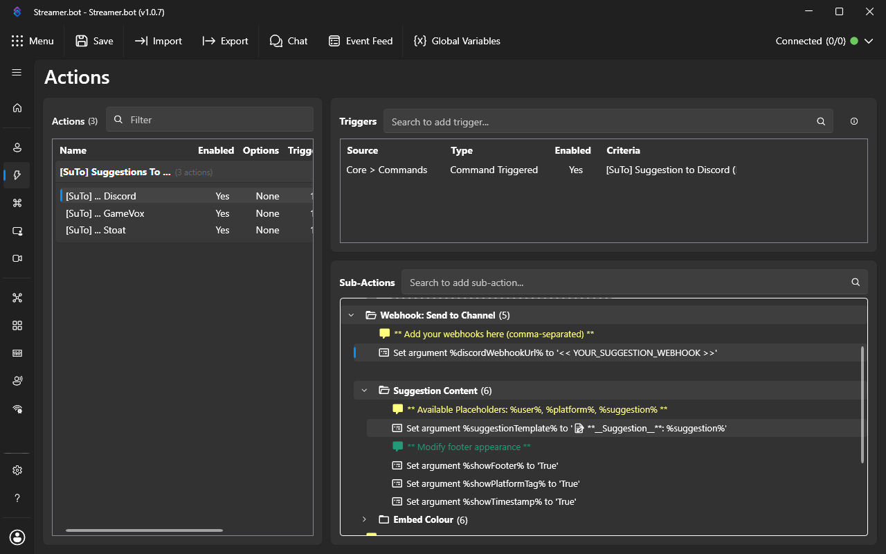
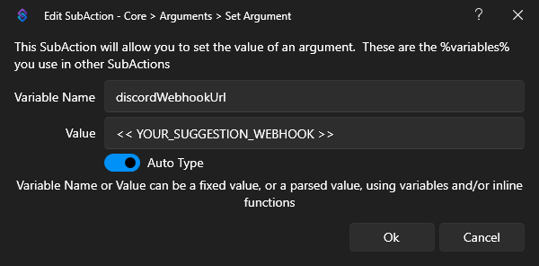
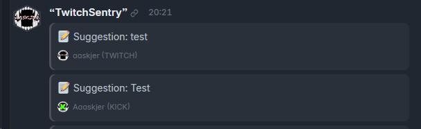

# 📝 SuTo — Setup Guide

Every argument of the three actions, what it does and what it starts as. If you are here to find out what SuTo is or how to install it, start on the **[overview page](README.md)**.

**[Overview](README.md)** · **[Import string](Import-String.md)** · **[Changelog](https://github.com/aaskjer/SuTo/releases)** · **[Report a problem](https://github.com/aaskjer/SuTo/issues)**

All settings are **Set Argument** sub-actions inside the actions **[SuTo] ... Discord**, **[SuTo] ... Stoat** and **[SuTo] ... GameVox** (**Actions & Queues → Actions** in Streamer.bot). Double-click one to change its **Value**, then **Ok**. A sub-action that is switched off (greyed out) does not count; right-click → **Enabled** switches it on.

---

# What every action shares

## Suggestion Content

| Argument | Starts as | What it does |
|---|---|---|
| `suggestionTemplate` | Discord: `📝 **__Suggestion__**: %suggestion%` Stoat: `📝 suggests: %suggestion%` GameVox: `📝 Suggestion: %suggestion%` | The text of the post. Placeholders: `%suggestion%` (what the viewer wrote), `%user%` (their name), `%platform%` (`TWITCH`, `YOUTUBE` or `KICK`). |
| `showTimestamp` | `True` | Date and time of the suggestion next to name and platform. See [Date and time](#date-and-time). |

## Embed Colour

| Argument | Starts as | What it does |
|---|---|---|
| `randomColour` | `False` | `True` gives every post a random colour and ignores the three below. |
| `colourTwitch` | `#9146FF` | Colour of the bar beside a suggestion from Twitch. |
| `colourYouTube` | `#FF0000` | … from YouTube. |
| `colourKick` | `#53FC18` | … from Kick. |

Colours are hex values: `#9146FF`, `9146FF` and `0x9146FF` all work. Anything else (a colour name, a short `#FFF`) gives a warning in the log and the default colour.

## The webhook URL

Each action has one webhook argument in its **Webhook: Send to Channel** group. It starts as a placeholder like `<< YOUR_SUGGESTION_WEBHOOK >>`; replace that with your URL. **Several URLs separated by commas** post the same suggestion to every one of them.

## The chat confirmation

At the bottom of each action, **Edit the respond messages per platform** holds a switch with one message per platform: `@%user% has made a suggestion!`. Change the text there. It is sent with your bot account (or the broadcaster account if there is no bot), and only when the post reached every webhook. If something failed, the viewer gets no confirmation and the log says why.

## Date and time

| Server | What shows | Format |
|---|---|---|
| Discord | Discord's own timestamp beside the footer, e.g. *Today at 20:21* | Each reader sees their own time zone and language; nothing to set |
| Stoat, GameVox | Your PC's time as text, e.g. `aaskjer (TWITCH) • 2026-10-25 20:21` | `timestampFormat` |

`timestampFormat` takes a [.NET date format](https://learn.microsoft.com/dotnet/standard/base-types/custom-date-and-time-format-strings):

| `timestampFormat` | Shows |
|---|---|
| `yyyy-MM-dd HH:mm` (default) | 2026-10-25 20:21 |
| `dd.MM.yyyy HH:mm` | 25.10.2026 20:21 |
| `MMM d, h:mm tt` | Oct 25, 8:21 PM |
| `HH:mm` | 20:21 |

An invalid format gives a warning in the log and the default.

## Do not touch

The **No Touchy!** group looks up the viewer on Kick (for the Kick avatar) and runs the code. Leave it as it is.

---

# [SuTo] ... Discord

| Argument | Group | Starts as | What it does |
|---|---|---|---|
| `discordWebhookUrl` | Webhook: Send to Channel | `<< YOUR_SUGGESTION_WEBHOOK >>` | The channel's webhook URL. Channel settings → Integrations → Webhooks → New Webhook → Copy Webhook URL. |
| `showFooter` | Suggestion Content | `True` | The viewer's avatar and name under the post. |
| `showPlatformTag` | Suggestion Content | `True` | `(TWITCH)`, `(YOUTUBE)` or `(KICK)` after the name. |

`suggestionTemplate` takes Discord Markdown: `**bold**`, `__underline__`, `*italic*`.

## Forums and threads

The group **Webhook: Send to Forum or Threads** is for a forum channel, or for one thread. All its arguments start switched off; switch on what you use.

| Argument | Starts as | What it does |
|---|---|---|
| `discordForumWebhookUrl` | `<< YOUR_FORUM_WEBHOOK >>` (off) | A webhook of the forum channel. When it is on, it is used instead of `discordWebhookUrl`. |
| `discordThreadName` | `Thread_Name` (off) | **Separate Forum Threads:** every suggestion opens a new forum post with this title. `%targetUser%`, `%user%` and `%userName%` become the viewer's name, e.g. `Suggested by %targetUser%`. Longer than 100 characters is cut. |
| `discordThreadId` | `Forum_Thread_ID` (off) | **All suggestions in a single Thread:** every suggestion goes into this existing thread or forum post. Right-click the thread in Discord → **Copy Thread ID** (needs Developer Mode under Settings → Advanced). Only digits. |

Use one of the two: with both on, the thread ID wins. A forum webhook needs one of them, or Discord refuses the post.

---

# [SuTo] ... Stoat

| Argument | Group | Starts as | What it does |
|---|---|---|---|
| `stoatSuggestionWebhook` | Webhook: Send to Channel | `<< YOUR_WEBHOOK >>` | The channel's webhook URL, `https://api.stoat.chat/webhooks/{id}/{token}`. |
| `timestampFormat` | Suggestion Content | `yyyy-MM-dd HH:mm` | See [Date and time](#date-and-time). |

The post shows the suggestion, then the viewer's avatar (Twitch and Kick), name, platform and time underneath. `suggestionTemplate` takes Markdown.

**Optional extras**, which are not in the action: add a **Set Argument** to its **Suggestion Content** group if you want one.

| Argument | Example | What it does |
|---|---|---|
| `suggestionFooterTemplate` | `by %user% on %platform%` | The line under the suggestion. Starts as `%user% (%platform%)`. |
| `iconTwitch`, `iconYouTube`, `iconKick` | `https://example.com/twitch.png` | A fixed picture instead of the viewer's avatar, for every suggestion from that platform. |

---

# [SuTo] ... GameVox

| Argument | Group | Starts as | What it does |
|---|---|---|---|
| `gameVoxWebhookUrl` | Webhook: Send to Channel | `<< YOUR_GAMEVOX_WEBHOOK >>` | The execute URL of an app webhook: [GameVox Developer Portal](https://developers.gamevox.com/docs/webhooks) → your application → **Webhooks** → **New Webhook**. Copy it right away; GameVox shows it only once. |
| `showFooter` | Suggestion Content | `True` | The viewer's avatar and name under the post. |
| `showPlatformTag` | Suggestion Content | `True` | `(TWITCH)`, `(YOUTUBE)` or `(KICK)` after the name. |
| `timestampFormat` | Suggestion Content | `yyyy-MM-dd HH:mm` | See [Date and time](#date-and-time). |

- GameVox shows no Markdown in embeds, so the template is plain text.
- The post comes from your GameVox application's bot, with its name and picture. GameVox does not let a webhook change them.
- Webhooks only reach cloud-hosted GameVox servers, not self-hosted ones.
- With `showFooter` off and `showTimestamp` on, the footer shows only the time.

---

# When nothing arrives

Open Streamer.bot's **Logs** tab and look for the line from the action:

| The log says | What to do |
|---|---|
| `... is not a webhook URL. Replace the placeholder ...` | The webhook argument still holds `<< ... >>`, or the URL is cut off. Paste the full URL. |
| `... webhook URL is missing or empty` | The webhook argument is empty or switched off. |
| `The forum webhook needs 'discordThreadName' ... or 'discordThreadId'` | Switch on one of the two (Discord forums). |
| `'discordThreadId' must be the numeric ID ...` | The thread ID still says `Forum_Thread_ID`, or holds more than digits. |
| `Could not parse webhook id/token ...` (Stoat) | The URL is not `https://api.stoat.chat/webhooks/{id}/{token}`. |
| `GameVox error (401 ...)` | The token in the URL is wrong. GameVox shows it only once: create a new webhook if it is lost. |
| `GameVox error (404 ...)` | The webhook or its channel was deleted, or the server is self-hosted. |
| `Discord error (...)` | Discord's own answer follows; most often the webhook was deleted. |
| `'colourTwitch' is not a hex colour ...` | Only a warning: the post went out in the default colour. |
| `Suggestion message is missing or empty` | The viewer typed the command without a text. Nothing to fix. |

A webhook URL never appears in full in the log: the secret token is replaced by `***`.

If none of this helps, [open an issue](https://github.com/aaskjer/SuTo/issues) with the log line.
