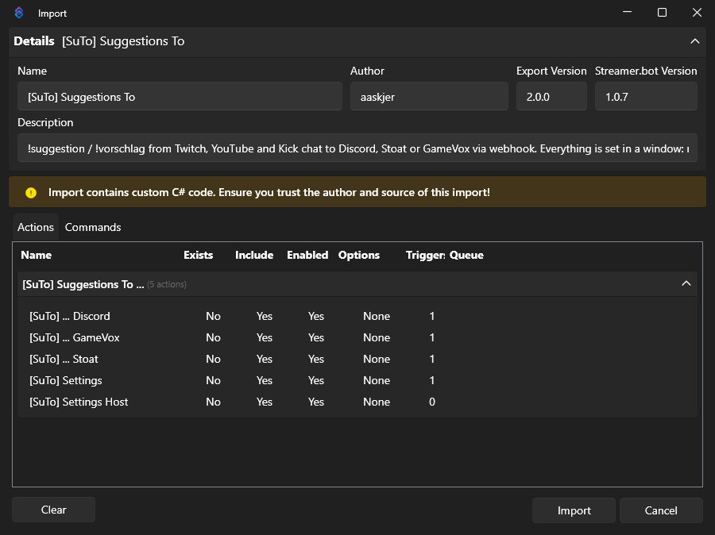
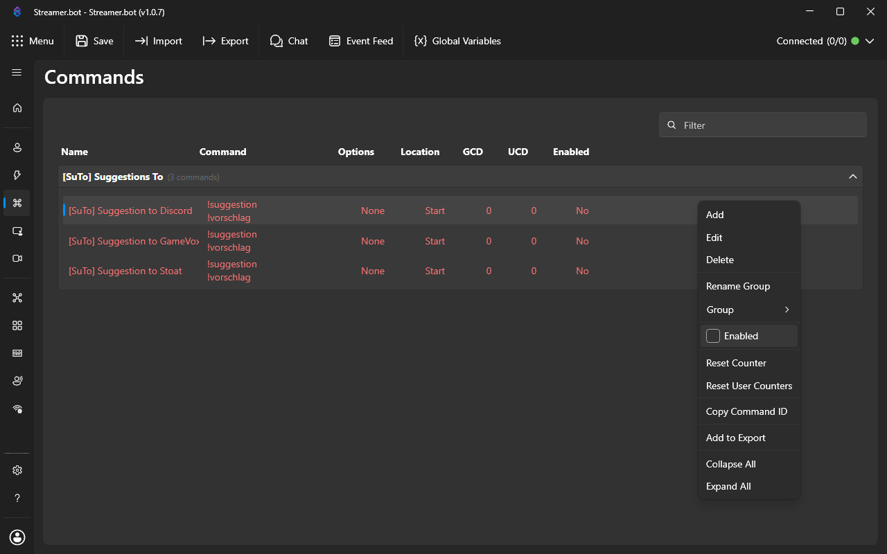
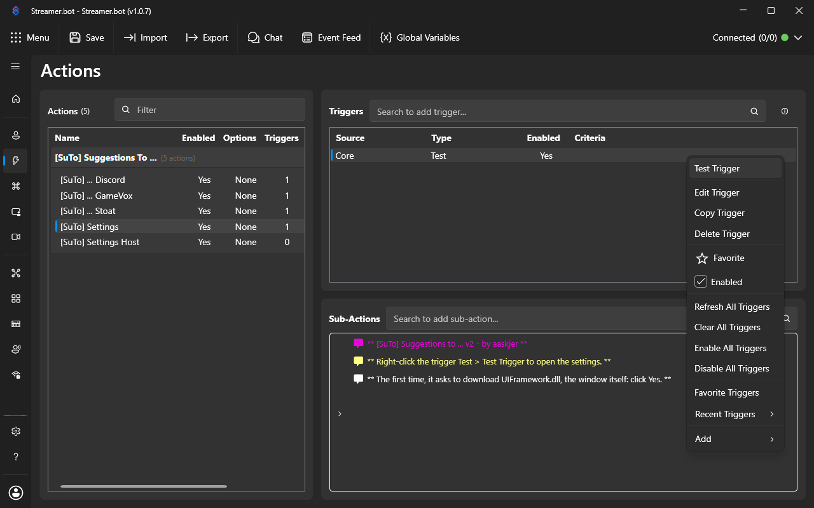
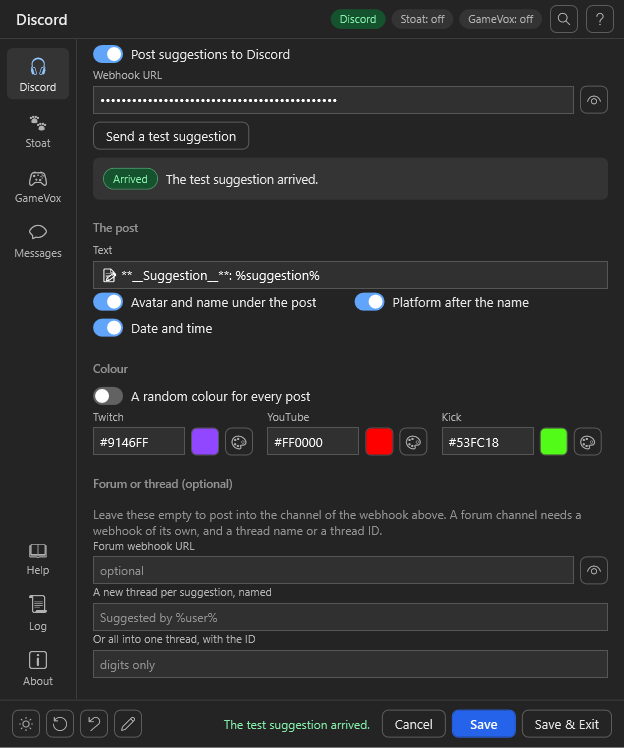
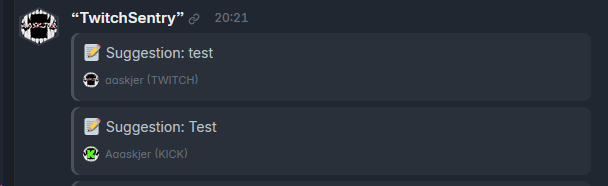
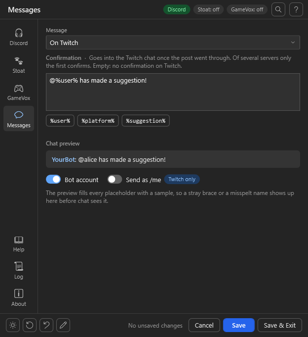

# 📝 SuTo — Setup Guide

How to install SuTo, then every setting of its window: what it does and what it starts as. What SuTo is and does is on the **[overview page](README.md)**.

**[Overview](README.md)** · **[Import string](Import-String.md)** · **[Changelog](https://github.com/aaskjer/SuTo/releases)** · **[Report a problem](https://github.com/aaskjer/SuTo/issues)**

---

# Install

### 1. Import

Download **`SuggestionsTo.sb`** from the [latest release](https://github.com/aaskjer/SuTo/releases/latest), or copy the string from [Import-String.md](Import-String.md). In Streamer.bot (1.0 or newer) click **Import** and drag the file in, or paste the string. The window lists the five actions and, on its second tab, the three commands; click **Import** and answer **Yes** to the question about C# code.

### 2. Enable the command

Streamer.bot switches every imported command off, and says so in a notice. Open **Commands**, find the group **[SuTo] Suggestions To**, right-click the command of each server you post to and tick **Enabled**.

### 3. Open the settings

Open **Actions & Queues → Actions**, select the action **[SuTo] Settings**, right-click its trigger **Test** and choose **Test Trigger**. The first time, a dialog asks whether to download `UIFramework.dll`, the window itself. Click **Yes**.

### 4. Switch on your server

Every server has a page of its own: **Discord**, **Stoat**, **GameVox**. On the page of the one you post to:

1. Switch on **Post suggestions to …**.
2. Paste the channel's webhook URL into **Webhook URL**.
3. Press **Send a test suggestion**. It posts a test under your name, and the box under the button says whether it arrived, or why not.
4. Press **Save**.

| Server | Where the URL comes from |
|---|---|
| Discord | Channel settings → Integrations → Webhooks → New Webhook → Copy Webhook URL |
| Stoat | The channel's webhook settings; the URL looks like `https://api.stoat.chat/webhooks/{id}/{token}` |
| GameVox | [GameVox Developer Portal](https://developers.gamevox.com/docs/webhooks) → your application → Webhooks → New Webhook. The URL is shown only once. |

That is it. Type `!suggestion test` in your chat.

Everything else (text, colours, footer, time format, Discord forums, the answer in chat) is optional and explained below.

### Updating from 1.0.0

Import the new version over the old one, then open the settings.

- **Your settings come along.** They were **Set Argument** sub-actions of the three actions, which the import replaces. The first time the window opens, it takes their values (webhooks, texts, colours, the chat confirmation) from Streamer.bot's own backup of your actions (the folder `backup`) and shows them as unsaved changes. Without such a backup the window opens with the defaults.
- **Switch on the servers you post to, look the values over, and press Save.** Until then nothing is posted.
- A webhook you never set stays empty: the `<< YOUR_… >>` of version 1 only said what goes there.
- The chat confirmation is now one text per platform for all three servers. The texts of the Discord action are taken over; if you had changed them only in the Stoat or the GameVox action, type them in again on the **Messages** page.
- **Enable the commands again.** Streamer.bot switches them off with every import, also with one over commands that were on: right-click each one you use → **Enabled**.

---

# What lands where

| | Discord | Stoat | GameVox |
|---|---|---|---|
| Suggestion text | Embed, with Markdown | Embed, with Markdown | Embed, plain text (GameVox shows no Markdown) |
| Colour per platform | ✅ | ✅ | ✅ |
| Viewer's avatar | Twitch, Kick; YouTube when Streamer.bot passes one | Twitch, Kick | Twitch, Kick; YouTube when Streamer.bot passes one |
| Name and platform | Footer | Under the text | Footer |
| Date and time | Discord's own timestamp, in each reader's time zone | Your PC's time, in your format | Your PC's time, in your format |
| Forum posts and threads | ✅ | — | — |

The chat confirmation (`@user has made a suggestion!`) is sent on the platform the suggestion came from, once per suggestion, and only when the post went through.

---

# Good to know

- **Webhooks are secrets.** Anyone with the URL can post to that channel. The window shows them as dots; do not reveal them on stream, do not share `Suggestions To\SuTo-Settings.json`, and create a new webhook if one leaks.
- **GameVox webhooks only reach cloud-hosted GameVox servers.** A self-hosted server answers with "not found".
- **The commands** are in Streamer.bot's **Commands** tab, group **[SuTo] Suggestions To**: one per server, all three on `!suggestion` and `!vorschlag`. Change the command words, cooldowns and permissions there, the same for all three. Streamer.bot switches them off with every import; enable the ones you use again after an update.
- **Leave the actions as they are.** The **No Touchy!** group looks up Kick avatars and runs the code, and **[SuTo] Settings Host** answers the settings window: do not delete or disable it, the window does not open without it. Nothing in them is a setting.
- **A server's action that is disabled or deleted** cannot post. The window shows it: the server's page is locked, and its pill in the header reads **action off** or **action missing**. Enable the action again, or import SuTo again.
- **Something not posting?** The **Log** page of the window shows what SuTo wrote into Streamer.bot's log: lines starting with `[SuTo/Discord]`, `[SuTo/Stoat]` or `[SuTo/GameVox]` say why. [When nothing arrives](#when-nothing-arrives) lists the usual ones.

---

# Settings

The settings are in a window: in the action **[SuTo] Settings**, right-click the trigger **Test** → **Test Trigger**. **Save** writes them to `Suggestions To\SuTo-Settings.json` in the Streamer.bot folder, and the next suggestion uses them. No import touches that file, so an update keeps your settings.

The pills in the window's header say which servers are switched on.

---

# What every server page shares

| Setting | Starts as | What it does |
|---|---|---|
| **Post suggestions to …** | off | Off: `!suggestion` does nothing for this server, and everything else on the page stays as it is. |
| **Webhook URL** | empty | The channel's webhook. **Several URLs separated by commas** post the same suggestion to every one of them. |
| **Send a test suggestion** | | Saves unsaved changes, posts a test under your name through the server's own action and says in the box below whether it arrived. Works while the server is switched off, and sends nothing to chat. |
| **Text** | Discord: `📝 **__Suggestion__**: %suggestion%` Stoat: `📝 suggests: %suggestion%` GameVox: `📝 Suggestion: %suggestion%` | The text of the post. Placeholders: `%suggestion%` (what the viewer wrote), `%user%` (their name), `%platform%` (`TWITCH`, `YOUTUBE` or `KICK`). |
| **Date and time** | on | Date and time of the suggestion next to name and platform. See [Date and time](#date-and-time). |
| **A random colour for every post** | off | On: every post gets a random colour, and the three below are not used. |
| **Twitch**, **YouTube**, **Kick** | `#9146FF`, `#FF0000`, `#53FC18` | Colour of the bar beside a suggestion from that platform. |

## Date and time

| Server | What shows | Format |
|---|---|---|
| Discord | Discord's own timestamp beside the footer, e.g. *Today at 20:21* | Each reader sees their own time zone and language; nothing to set |
| Stoat, GameVox | Your PC's time as text, e.g. `aaskjer (TWITCH) • 2026-10-25 20:21` | **Time format** |

**Time format** takes a [.NET date format](https://learn.microsoft.com/dotnet/standard/base-types/custom-date-and-time-format-strings):

| Time format | Shows |
|---|---|
| `yyyy-MM-dd HH:mm` (default) | 2026-10-25 20:21 |
| `dd.MM.yyyy HH:mm` | 25.10.2026 20:21 |
| `MMM d, h:mm tt` | Oct 25, 8:21 PM |
| `HH:mm` | 20:21 |

The window names an invalid format before it saves.

---

# Discord

| Setting | Starts as | What it does |
|---|---|---|
| **Avatar and name under the post** | on | The viewer's avatar and name in the post's footer. |
| **Platform after the name** | on | `(TWITCH)`, `(YOUTUBE)` or `(KICK)` after the name. |

**Text** takes Discord Markdown: `**bold**`, `__underline__`, `*italic*`.

## Forum or thread (optional)

For a forum channel, or for one thread. Leave all three empty to post into the channel of the webhook above.

| Setting | What it does |
|---|---|
| **Forum webhook URL** | A webhook of the forum channel. While it is set, it is used instead of the webhook URL above. |
| **A new thread per suggestion, named** | Every suggestion opens a new forum post with this title. `%user%` becomes the viewer's name, e.g. `Suggested by %user%`. Longer than 100 characters is cut. |
| **Or all into one thread, with the ID** | Every suggestion goes into this existing thread or forum post. Right-click the thread in Discord → **Copy Thread ID** (needs Developer Mode under Settings → Advanced). Only digits. |

Use one of the two: with both filled in, the thread ID wins. A forum webhook needs one of them, or Discord refuses the post; the window says so before it saves.

---

# Stoat

| Setting | Starts as | What it does |
|---|---|---|
| **Line under the text** | `%user% (%platform%)` | The line under the suggestion, after the viewer's avatar (Twitch and Kick). `%user%` and `%platform%` work here too. |
| **Time format** | `yyyy-MM-dd HH:mm` | See [Date and time](#date-and-time). |
| **Pictures (optional)**: From Twitch, From YouTube, From Kick | empty | The web address of a fixed picture instead of the viewer's avatar, for every suggestion from that platform. |

**Text** takes Markdown. The URL is always sent to `api.stoat.chat`, whatever host it names.

---

# GameVox

| Setting | Starts as | What it does |
|---|---|---|
| **Avatar and name under the post** | on | The viewer's avatar and name in the post's footer. |
| **Platform after the name** | on | `(TWITCH)`, `(YOUTUBE)` or `(KICK)` after the name. |
| **Time format** | `yyyy-MM-dd HH:mm` | See [Date and time](#date-and-time). |

- The webhook is the execute URL of an app webhook: [GameVox Developer Portal](https://developers.gamevox.com/docs/webhooks) → your application → **Webhooks** → **New Webhook**. Copy it right away; GameVox shows it only once.
- GameVox shows no Markdown in embeds, so the text is plain.
- The post comes from your GameVox application's bot, with its name and picture. GameVox does not let a webhook change them.
- With **Avatar and name** off and **Date and time** on, the footer shows only the time.

---

# Messages

The confirmation in chat, one text per platform: **On Twitch**, **On YouTube**, **On Kick**. Each starts as `@%user% has made a suggestion!`.

- It goes into the chat the suggestion came from, and only when the post reached every webhook of a server. If something failed, the viewer gets no confirmation and the log says why.
- A suggestion that went to several servers is confirmed once.
- `%user%` is the viewer's name, `%platform%` and `%suggestion%` as in the post. Any other `%argument%` of the chat message works as it does in Streamer.bot's own Send Message.
- An empty text sends no confirmation on that platform.
- **Bot account** sends it from your bot. Off, or without a bot account, the broadcaster account sends it.
- **Send as /me** sends it as a `/me` action. Twitch only: YouTube and Kick get the text as a message. Off at first.

---

# A second channel with its own command

The three actions read the settings file. A **Set Argument** sub-action named like a setting's key wins over the file, so a copy of an action can post somewhere else:

1. Duplicate the action, for example **[SuTo] ... Discord**, and give the copy a command of its own (`!feedback`).
2. In the copy, add **Set Argument** sub-actions above the **No Touchy!** group: `discordWebhookUrl` with the other channel's webhook, and whatever else should differ (`discordSuggestionTemplate`, `discordColourTwitch` …).

The keys are the names in `Suggestions To\SuTo-Settings.json`. The window does not show such an argument; it only counts for the action it is in.

---

# When nothing arrives

Open the **Log** page of the settings window, or Streamer.bot's **Logs** tab, and look for the line from the action:

| The log says | What to do |
|---|---|
| `Nothing is set up yet. Run the action '[SuTo] Settings' ...` | Nothing has been saved in the settings window yet. Open it, switch on a server, save. |
| `Discord is switched off in the settings.` (a debug line) | Switch the server on at the top of its page. |
| nothing at all | The server's command is off in Streamer.bot's **Commands** tab, as it is after every import. Right-click it → **Enabled**. |
| nothing at all, and the server's page in the window is locked | The server's action is disabled or deleted in Streamer.bot. The pill in the window's header says which. Enable it, or import SuTo again. |
| `No webhook URL is set. ...` | The server is switched on, but **Webhook URL** is empty. |
| `... is not a webhook URL. ...` | The URL is cut off, or the field holds something else. Paste the full URL. |
| `The forum webhook needs a thread name ... or a thread ID` | Fill in one of the two (Discord forums). |
| `The thread ID must be the numeric ID ...` | The thread ID holds more than digits. |
| `Could not parse webhook id/token ...` (Stoat) | The URL is not `https://api.stoat.chat/webhooks/{id}/{token}`. |
| `GameVox error (401 ...)` | The token in the URL is wrong. GameVox shows it only once: create a new webhook if it is lost. |
| `GameVox error (404 ...)` | The webhook or its channel was deleted, or the server is self-hosted. |
| `Discord error (...)` | Discord's own answer follows; most often the webhook was deleted. |
| `The colour for Twitch is not a hex colour ...` | Only a warning: the post went out in the default colour. |
| `Suggestion message is missing or empty` | The viewer typed the command without a text. Nothing to fix. |

A webhook URL never appears in full in the log: the secret token is replaced by `***`.

**The settings window does not open?** Its log lines start with `[SuTo/Settings]`. The first time, it needs the internet once, to download `UIFramework.dll`.

If none of this helps, [open an issue](https://github.com/aaskjer/SuTo/issues) with the log line.

---

# The files

In the Streamer.bot folder:

| File | What it holds |
|---|---|
| `Suggestions To\SuTo-Settings.json` | Everything the window saves, the webhook URLs included. Keep it to yourself. |
| `Suggestions To\SuTo-Settings.json.bak` | The settings before the last save. |
| `Suggestions To\uiframework.layout.json` | Your layout of the window: theme, language, renamed or hidden pages and fields. |
| `UIFramework\lib\<version>\UIFramework.dll` | The window itself, [UIFramework for streamer.bot](https://github.com/aaskjer/UIFramework-Streamer.bot) 2.6.0 or newer. It is not part of the import: the settings action downloads it the first time the window opens and offers the update when an older one is there. |
